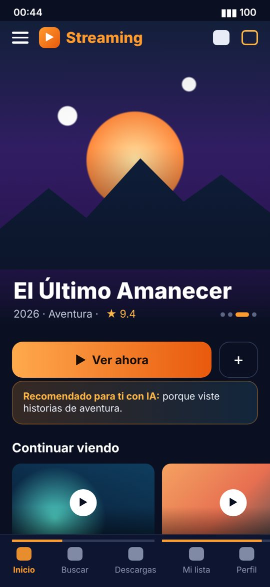
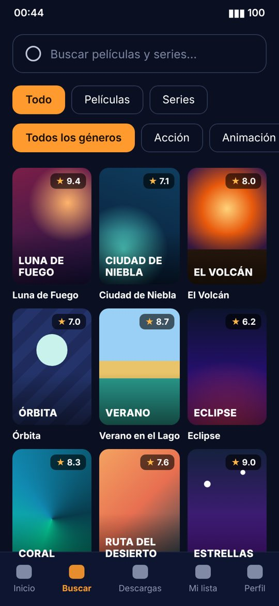
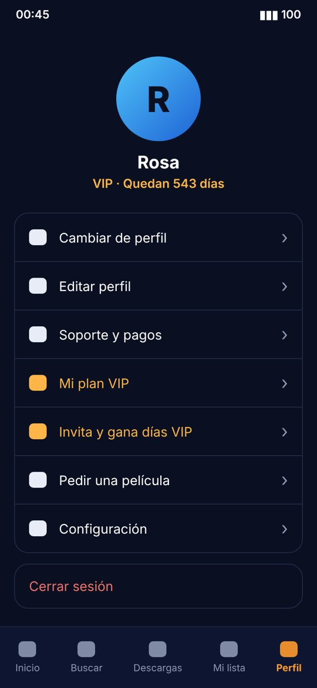
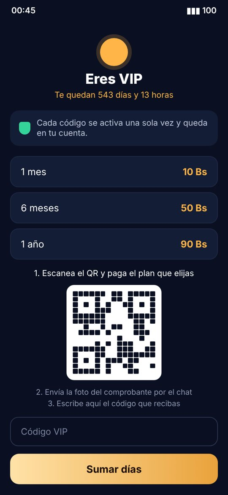

  
  
  
  

<h1 align="center">App de streaming</h1>

<b>Aplicación móvil de películas y series con cuentas, planes VIP y recomendaciones con IA</b>

  
  

---

> 🔒 **El código fuente es privado** y el nombre comercial no se muestra.
> Las capturas son representativas: los títulos y las portadas son de ejemplo.
> Si quieres una app parecida para tu negocio, [escríbeme](#-contacto).

## 📌 Sobre el proyecto

Diseñé y programé una app completa de streaming que ya tiene **usuarios activos**. La app reúne el catálogo, las cuentas de usuario, los pagos y el soporte en un solo lugar.

## ✨ Funcionalidades

**Para el usuario**
- Inicio con carrusel de estrenos, **"Continuar viendo"** con el progreso de cada episodio y "Lo más visto"
- **Recomendaciones con inteligencia artificial** según lo que ve cada persona
- Buscador con filtros por tipo (películas o series) y por género
- Secciones de películas, series, anime y K-dramas
- Mi lista, descargas y **varios perfiles en una misma cuenta**

**Cuentas y pagos**
- **Planes VIP** de 1 mes, 6 meses y 1 año, con contador de días restantes
- Pago por **QR** con envío del comprobante y **activación con código de un solo uso**
- **Programa de referidos:** invita a otros y gana días VIP
- Reproducción gratuita con anuncios para usuarios sin VIP

**Soporte y administración**
- **Chat de soporte** dentro de la app
- Pedido de películas por los usuarios
- Cuenta de administrador para gestionar el contenido y los códigos

## 🛠️ Tecnologías

## 📫 Contacto

**Juan José Mamani Machaca**, desarrollador web y móvil en La Paz, Bolivia

- Portafolio: [jose011011.github.io](https://jose011011.github.io)
- Correo: [juanmamani121432@gmail.com](mailto:juanmamani121432@gmail.com)
- WhatsApp: [+591 64240837](https://wa.me/59164240837)

---
© 2026 Juan José Mamani Machaca. Todos los derechos reservados.
